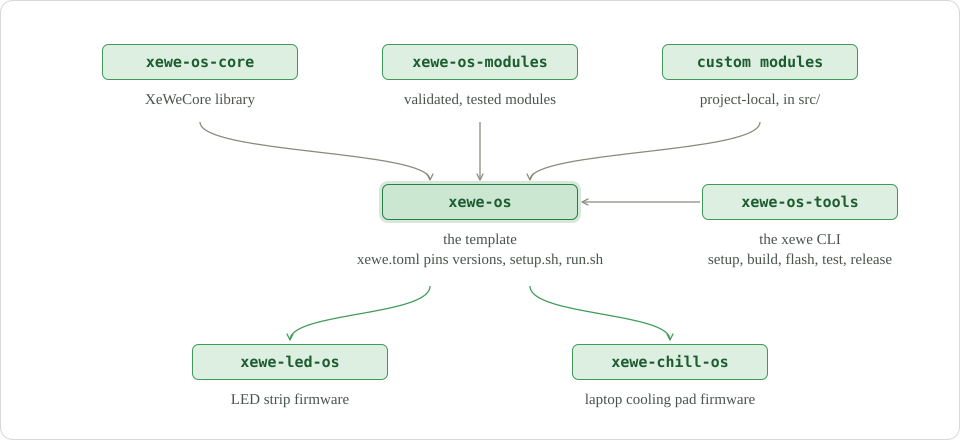

# xewe-os ecosystem

Firmware always contains reusable bits and pieces. xewe-os builds on this fact with a philosophy of
a highly modular framework that is ready for agent-first development.

What it has: [`xewe-os-core`](https://github.com/xewe-labs/xewe-os-core) contains the core
functions, such as serial port interaction, the CLI engine, memory storage and others. Then there
is a module repo, [`xewe-os-modules`](https://github.com/xewe-labs/xewe-os-modules), that has
validated and tested modules. For example, need buttons? Install buttons. Need LED control or a
fan? Install the module. Then, to build and test it, we have
[`xewe-os-tools`](https://github.com/xewe-labs/xewe-os-tools). It also contains some dev tools for
rapid prototyping, but its primary purpose is to compile and test the code. It all comes together
with [`xewe-os`](https://github.com/xewe-labs/xewe-os), a template that pulls the core, the modules
of your choice and the build tools together. With only two commands, `setup.sh` and `run.sh`, you
can go from an idea to flashed firmware.

<picture><source media="(prefers-color-scheme: dark)" srcset="ecosystem-dark.svg"></picture>

## Releases and CI/CD

Every release has a generated `release_card.md`: release notes, metadata, validator output, one
row per test with its result (hardware runs are marked apart from compile-only ones), plus the
logs. v3 marks the ecosystem unification.

* `xewe-os-tools`: no binaries, just the release tag.
* `xewe-os-core`: no binaries, just the release tag; its release card lists the unit and on-board
  tests, one test per row with its result.
* `xewe-os-modules`: a release per module (a `release_card.md` per module) and a set tag; still no
  binaries.
* `xewe-os`: release tags for the harness, plus precompiled binaries published as GitHub Release
  assets (never committed to git). Flashable from [maxdokukin.com](https://maxdokukin.com), and
  later from GitHub Pages.

From this ecosystem emerge xewe-led-os and xewe-chiller-os.

## xewe-led-os

[`xewe-led-os`](https://github.com/xewe-labs/xewe-led-os) is the LED strip firmware for ESP32-C3,
-C6 and -S3: every FastLED chipset selectable at runtime, 7 effects, a web page, HomeKit, Alexa,
Home Assistant, schedules and buttons. It is built on xewe-os 3.0 with the `led` and `led-web`
modules plus its own project-local modules.

Status: 3.0 is on branch `v3`, hardware verification in progress; the 2.x history is kept under
the `v2.3.0` tag.

## xewe-chiller-os

The laptop cooling pad firmware (fan, temperature and LED), currently
[`xewe-os-laptop-cooling-pad`](https://github.com/xewe-labs/xewe-os-laptop-cooling-pad). It will
be rebranded xewe-chiller-os and migrated to xewe-os 3.0 the same way.

## Links

* Ecosystem: [`xewe-os`](https://github.com/xewe-labs/xewe-os) ·
  [`xewe-os-core`](https://github.com/xewe-labs/xewe-os-core) ·
  [`xewe-os-modules`](https://github.com/xewe-labs/xewe-os-modules) ·
  [`xewe-os-tools`](https://github.com/xewe-labs/xewe-os-tools)
* Why it is shaped this way: [xewe-os/doc/architecture.md](https://github.com/xewe-labs/xewe-os/blob/main/doc/architecture.md)
* Arduino IDE only? Install `XeWeCore` from the Library Manager and start with the
  [`01_Hello`](https://github.com/xewe-labs/xewe-os-core/tree/main/examples/01_Hello) example.
* Home Assistant integration: [`xewe-led-os-homeassistant`](https://github.com/xewe-labs/xewe-led-os-homeassistant)
* Contributing: [CONTRIBUTING.md](https://github.com/xewe-labs/.github/blob/main/CONTRIBUTING.md);
  a new module starts with a [module proposal](https://github.com/xewe-labs/xewe-os-modules/issues/new?template=module_proposal.md).

Everything here is GPL-3.0-only unless a repository says otherwise.
