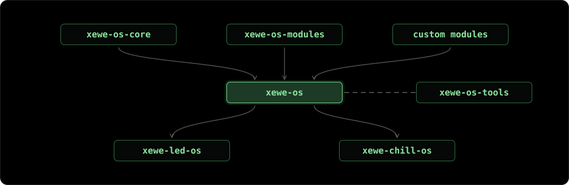

# xewe-os ecosystem

Every firmware is built from reusable pieces. xewe-os builds on that fact: it is a modular
framework made for development with AI coding assistants.

[`xewe-os-core`](https://github.com/xewe-labs/xewe-os-core) holds the core functions, such as
serial port interaction, the CLI engine and storage. [`xewe-os-modules`](https://github.com/xewe-labs/xewe-os-modules)
holds validated and tested modules: need buttons, LED control or a fan? Select that module.
[`xewe-os-tools`](https://github.com/xewe-labs/xewe-os-tools) compiles and tests the code, and also
carries a few tools for rapid prototyping. [`xewe-os`](https://github.com/xewe-labs/xewe-os) brings
it all together: a template that pulls in the core, the modules you choose and the build tools.
Two commands, `./setup.sh` and `./run.sh`, take you from an idea to flashed firmware.

## Releases and CI/CD

Every release has a generated `release_card.md` with the release notes, the metadata, the
validator output, one row per test with its result (hardware runs are marked apart from
compile-only ones) and the logs. Version 3 unified the ecosystem.

* `xewe-os-tools` releases a tag, with no binaries.
* `xewe-os-core` releases a tag, with no binaries. Its release card lists the unit and on-board
  tests, one per row with its result.
* `xewe-os-modules` releases each module with its own tag and `release_card.md`, plus a set tag,
  with no binaries.
* `xewe-os` releases a tag, plus precompiled binaries published as GitHub Release assets and never
  committed to git. They are flashable from [maxdokukin.com](https://maxdokukin.com), and later
  from GitHub Pages.

xewe-led-os and xewe-chill-os are built on this ecosystem.

## xewe-led-os

[`xewe-led-os`](https://github.com/xewe-labs/xewe-led-os) is the LED strip firmware for ESP32-C3,
-C6 and -S3: every FastLED chipset selectable at runtime, 7 effects, a web page, HomeKit, Alexa,
Home Assistant, schedules and buttons. It is built on xewe-os 3.0 with the `led` and `led-web`
modules plus its own project-local modules.

Version 3.0.0 is released, and the 2.x history is kept under the `v2.3.0` tag.

## xewe-chill-os

[`xewe-chill-os`](https://github.com/xewe-labs/xewe-chill-os) is the laptop cooling pad firmware
(fan, temperature and LED) for ESP32-C3, -C6 and -S3, built on xewe-os. Version 1.0.0 builds for
all three chips and has not yet run on the assembled pad.

## Repositories

### Ecosystem

* [`xewe-os`](https://github.com/xewe-labs/xewe-os): lightweight OS for ESP32 and Arduino; the template
* [`xewe-os-core`](https://github.com/xewe-labs/xewe-os-core): the XeWeCore library: serial, CLI engine, storage
* [`xewe-os-modules`](https://github.com/xewe-labs/xewe-os-modules): every xewe-os module, fetched by `./setup.sh`
* [`xewe-os-tools`](https://github.com/xewe-labs/xewe-os-tools): the `xewe` CLI: setup, build, flash, test, release
* [`.github`](https://github.com/xewe-labs/.github): this profile, the organization guidelines, CONTRIBUTING.md and the shared templates

### xewe-led-os

* [`xewe-led-os`](https://github.com/xewe-labs/xewe-led-os): LED strip firmware for ESP32-C3, -C6 and -S3
* [`xewe-led-os-homeassistant`](https://github.com/xewe-labs/xewe-led-os-homeassistant): Home Assistant integration for XeWe LED OS devices
* [`library-homespan`](https://github.com/xewe-labs/library-homespan): fork: HomeKit library for the Arduino-ESP32 (archived)
* [`library-espalexa`](https://github.com/xewe-labs/library-espalexa): fork: Alexa voice control for ESP8266/ESP32 (archived)
* [`library-websockets`](https://github.com/xewe-labs/library-websockets): fork: arduinoWebSockets (archived)
* [`led-web-draft`](https://github.com/xewe-labs/led-web-draft): simple web interface to control LED lights (archived)

### xewe-chill-os

* [`xewe-chill-os`](https://github.com/xewe-labs/xewe-chill-os): laptop cooling pad firmware (fan, temperature, LED)

### Earlier LED projects (archived)

* [`led-bathroom`](https://github.com/xewe-labs/led-bathroom): Alexa and HomeKit lights around a bathroom mirror (archived)
* [`led-bed`](https://github.com/xewe-labs/led-bed): LED lights controlled by Amazon Alexa (archived)
* [`led-buggy`](https://github.com/xewe-labs/led-buggy): animated RGB strips and a glowing logo for a dune buggy (archived)
* [`led-ceiling`](https://github.com/xewe-labs/led-ceiling): voice-controlled ceiling lights on an ESP8266 (archived)
* [`led-desk`](https://github.com/xewe-labs/led-desk): ESP8266 desk and ceiling lights for HomeKit and Alexa (archived)
* [`led-hookah-os`](https://github.com/xewe-labs/led-hookah-os): LED lights that illuminate a hookah's flask (archived)
* [`led-poster-os`](https://github.com/xewe-labs/led-poster-os): competition poster with live LED lights controlled by Arduino (archived)
* [`led-quantum-controller`](https://github.com/xewe-labs/led-quantum-controller): Arduino Nano firmware and Windows app for four PC lighting channels (archived)
* [`led-retro-christmas-lights`](https://github.com/xewe-labs/led-retro-christmas-lights): an addressable LED strip in the Christmas mood (archived)
* [`led-suv-bot`](https://github.com/xewe-labs/led-suv-bot): solar-charged cocktail stand with glass-triggered LED animations (archived)
* [`led-wardrobe`](https://github.com/xewe-labs/led-wardrobe): smart wardrobe lighting on an ESP8266 with HomeKit and Alexa (archived)

Why it is shaped this way: [xewe-os/doc/XEWE_OS_ECOSYSTEM.md](https://github.com/xewe-labs/xewe-os/blob/main/doc/XEWE_OS_ECOSYSTEM.md).

Arduino IDE only? Install `XeWeCore` from the Library Manager and start with the
[`01_Hello`](https://github.com/xewe-labs/xewe-os-core/tree/main/examples/01_Hello) example.

Contributing: [CONTRIBUTING.md](https://github.com/xewe-labs/.github/blob/main/CONTRIBUTING.md);
a new module starts with a [module proposal](https://github.com/xewe-labs/xewe-os-modules/issues/new?template=MODULE_PROPOSAL.md).

Everything here is GPL-3.0-only unless a repository says otherwise.
