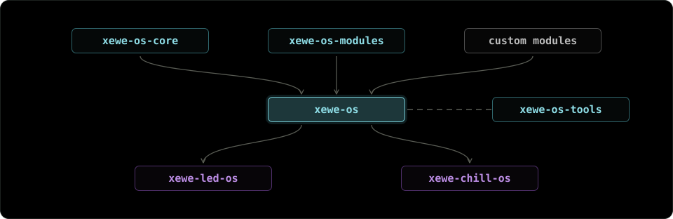

# xewe-os ecosystem

Every firmware is built from reusable pieces, and xewe-os is the modular framework that puts them
together. It is made for development with AI coding assistants. Two commands, `./setup.sh` and
`./run.sh`, take you from an idea to flashed firmware.

## Repositories

### Ecosystem

* [`xewe-os`](https://github.com/xewe-labs/xewe-os): lightweight OS for ESP32 and Arduino; the template
* [`xewe-os-core`](https://github.com/xewe-labs/xewe-os-core): the XeWeCore library: serial, CLI engine, storage
* [`xewe-os-modules`](https://github.com/xewe-labs/xewe-os-modules): every xewe-os module, fetched by `./setup.sh`
* [`xewe-os-tools`](https://github.com/xewe-labs/xewe-os-tools): the `xewe` CLI: setup, build, flash, test, release

### xewe-led-os

* [`xewe-led-os`](https://github.com/xewe-labs/xewe-led-os): LED strip firmware for ESP32-C3, -C6 and -S3
* [`xewe-led-os-homeassistant`](https://github.com/xewe-labs/xewe-led-os-homeassistant): Home Assistant integration for XeWe LED OS devices

### xewe-chill-os

* [`xewe-chill-os`](https://github.com/xewe-labs/xewe-chill-os): laptop cooling pad firmware (fan, temperature, LED)

### Earlier LED projects (archived)

* [`led-bathroom`](https://github.com/xewe-labs/led-bathroom): Alexa and HomeKit lights around a bathroom mirror (archived)
* [`led-bed`](https://github.com/xewe-labs/led-bed): LED lights controlled by Amazon Alexa (archived)
* [`led-buggy`](https://github.com/xewe-labs/led-buggy): animated RGB strips and a glowing logo for a dune buggy (archived)
* [`led-ceiling`](https://github.com/xewe-labs/led-ceiling): voice-controlled ceiling lights on an ESP8266 (archived)
* [`led-desk`](https://github.com/xewe-labs/led-desk): ESP8266 desk and ceiling lights for HomeKit and Alexa (archived)
* [`led-hookah-os`](https://github.com/xewe-labs/led-hookah-os): LED lights that illuminate a hookah's flask (archived)
* [`led-poster-os`](https://github.com/xewe-labs/led-poster-os): competition poster with live LED lights controlled by Arduino (archived)
* [`led-quantum-controller`](https://github.com/xewe-labs/led-quantum-controller): Arduino Nano firmware and Windows app for four PC lighting channels (archived)
* [`led-retro-christmas-lights`](https://github.com/xewe-labs/led-retro-christmas-lights): an addressable LED strip in the Christmas mood (archived)
* [`led-suv-bot`](https://github.com/xewe-labs/led-suv-bot): solar-charged cocktail stand with glass-triggered LED animations (archived)
* [`led-wardrobe`](https://github.com/xewe-labs/led-wardrobe): smart wardrobe lighting on an ESP8266 with HomeKit and Alexa (archived)
* [`led-web-draft`](https://github.com/xewe-labs/led-web-draft): simple web interface to control LED lights (archived)

Why it is shaped this way: [xewe-os/doc/XEWE_OS_ECOSYSTEM.md](https://github.com/xewe-labs/xewe-os/blob/main/doc/XEWE_OS_ECOSYSTEM.md).
Arduino IDE only? Install `XeWeCore` from the Library Manager and start with the
[`01_Hello`](https://github.com/xewe-labs/xewe-os-core/tree/main/examples/01_Hello) example.
To contribute, read [CONTRIBUTING.md](https://github.com/xewe-labs/.github/blob/main/CONTRIBUTING.md);
a new module starts with a [module proposal](https://github.com/xewe-labs/xewe-os-modules/issues/new?template=MODULE_PROPOSAL.md).
Everything here is GPL-3.0-only unless a repository says otherwise.
